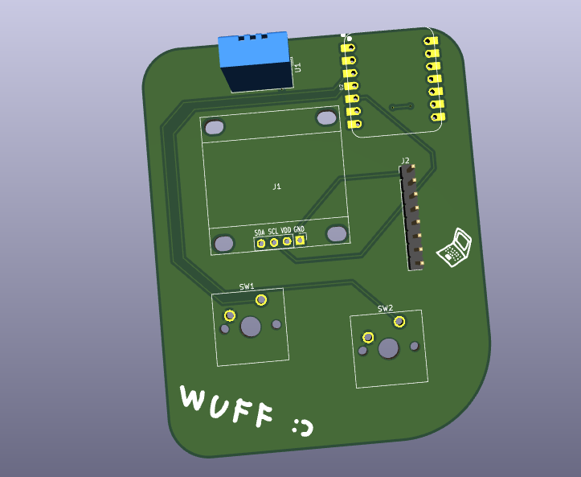

# wuff's Starbie

A homemade portable Tamagotchi. Built using the Half-Life guide from Hack Club.



## Why this?

I decided it was time to build something other than just another software project, so I joined YSWS Half-Life, where I was able to build the project from scratch using a guide.

## Features

- XIAO ESP32 C3
- OLED 0.96
- MPU6050
- DHT11
- Custom PCB

## Repository Structure

```
Starbie/
├── Starbie_firmware/
   ├── Starbie.ino     # Firmware file
├── Starbie_PCB        # Schematic file from PCB
├── imgs               # Images for README
├── BOM.md             # Bill of materials
├── JOURNAL.md         # Log of every hour of time spent building
├── LICENSE            # File with license
├── README             # File that you read now
```

## Credits

Thanks Hack Club and Half Life for giving me the motivation to start with hardware projects.

## License

The project is licensed under the GNU General Public License v3.0. See the LICENSE file for details.

## Contact

- Discord \_anik2010\_
- Email: wuff@wuffdev.pl or kacper5555544444@gmail.com
- Hack Club Slack: wuff